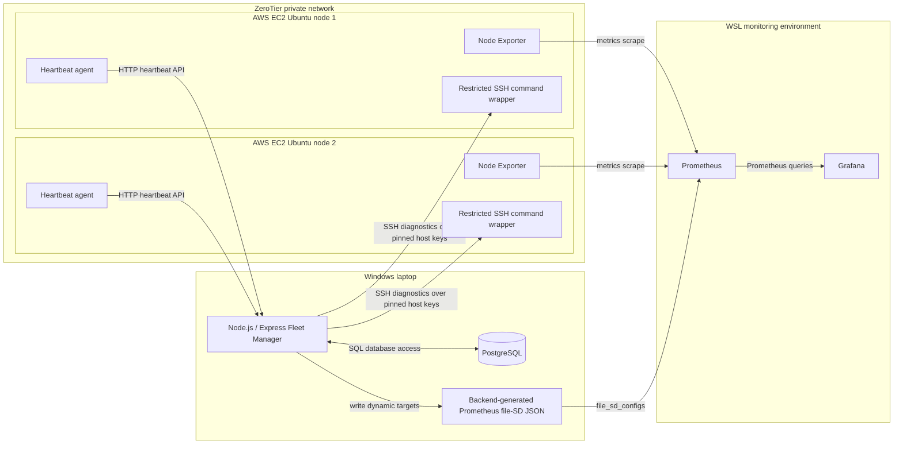
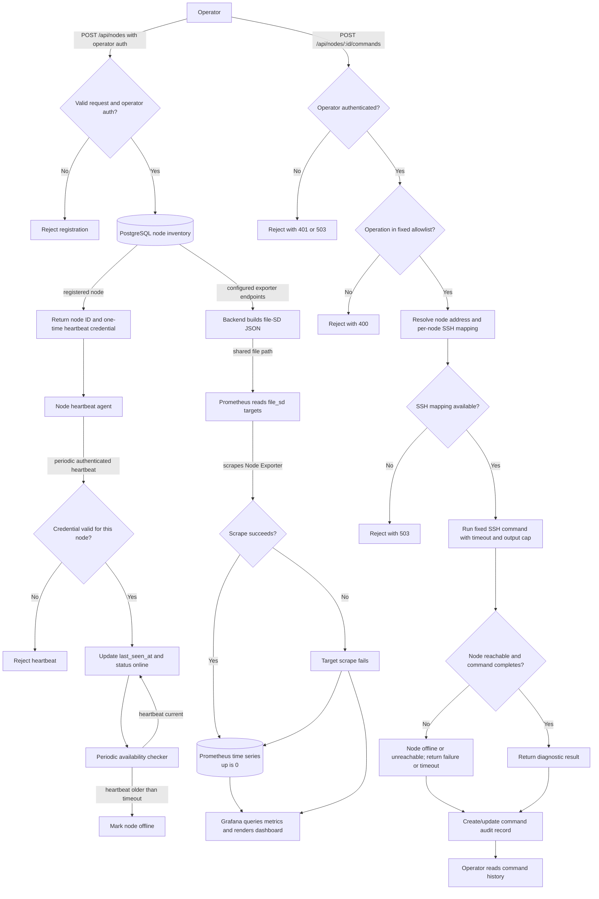

# Distributed Linux Fleet Manager

A Node.js and Express service for registering Linux servers, tracking authenticated heartbeats, publishing Prometheus discovery targets, and running a small allowlist of audited SSH diagnostics. The demonstration deployment uses a Windows backend, PostgreSQL, two AWS EC2 Ubuntu nodes connected over ZeroTier, and Prometheus and Grafana running in WSL.

## Overview

Operating a small Linux fleet requires a consistent inventory, a way to distinguish stale nodes from healthy ones, usable system metrics, and controlled access for diagnostics. This project brings those workflows together through a backend API and supporting Linux scripts.

The backend manages node inventory and heartbeat state in PostgreSQL. It can publish configured Node Exporter endpoints as Prometheus file-based service discovery JSON. Prometheus scrapes the exporters, while Grafana queries Prometheus to display metrics. A separate authenticated API path can run fixed diagnostic operations over SSH and records operation outcomes in an audit table.

AWS instances, ZeroTier membership, Prometheus configuration, and Grafana dashboards are prepared and administered separately. The application does not create cloud instances or configure the private network.

## Objectives

- Maintain a central inventory of registered Linux nodes.
- Authenticate node heartbeats and mark stale nodes offline.
- Discover configured Node Exporter endpoints without maintaining a static target list by hand.
- Visualize host metrics through Prometheus and Grafana.
- Provide restricted, auditable SSH diagnostics without accepting arbitrary commands.

## Implemented features

- Operator-authenticated node registration, listing, and detail lookup.
- Per-node bearer credentials for heartbeat, credential rotation, and revocation; the database stores credential hashes.
- Configurable heartbeat expiry and periodic offline detection.
- Trusted local tooling to provision exporter endpoints.
- Optional periodic, atomic Prometheus file-SD publication from PostgreSQL; nodes without configured endpoints are omitted.
- Seven fixed SSH operations: `uptime`, `disk_usage`, `memory_usage`, `kernel_info`, `disk_usage_all`, `memory_usage_mb`, and `node_exporter_status`.
- Separate fleet-operator authentication for management and remote-diagnostic routes.
- Remote-operation audit history with status, timestamps, exit code, and error code; command output is not persisted.
- Automated tests using Node.js's built-in test runner.

## System Architecture and Workflow

### Diagram 1 — System Architecture



The required ZeroTier clients, memberships, and network rules are configured by an operator. The Windows backend generates the discovery file; Prometheus's own configuration must separately point to that file. WSL Prometheus must be able to read it and reach the node exporters.

### Diagram 2 — End-to-End System Workflow



Remote-operation requests are authenticated before execution. Unapproved operation names are rejected before SSH or audit-row creation. For approved operations, the audit row is created before SSH and updated with its result. A missing or invalid per-node SSH mapping fails closed. An unreachable host or failed command is returned as a failed operation and recorded; a timeout is recorded as `timed_out`. The controller does not use heartbeat status as an SSH precondition.

## End-to-end workflow

1. An operator registers a node through the Fleet Manager API. The backend validates its name, hostname, and IP address, then stores inventory in PostgreSQL.
2. Registration returns a credential once; only its hash is stored. The matching Linux heartbeat agent sends it in the `Authorization` header on a periodic heartbeat request.
3. A valid heartbeat updates `last_seen_at` and sets the node status to `online`. The availability checker marks an online node offline after its last heartbeat exceeds the configured timeout. A later valid heartbeat brings it online again.
4. A trusted operator provisions a Node Exporter address and port for each node. When discovery output is configured, the backend reads endpoint data from PostgreSQL and atomically refreshes a dedicated file-SD JSON file.
5. Separately configured Prometheus reads that file and scrapes Node Exporter on the nodes. The backend does not edit or reload Prometheus configuration.
6. Grafana queries Prometheus and displays the selected dashboards. The dashboard assets are managed outside this repository.
7. An operator can request an allowlisted SSH diagnostic. The backend resolves the registered node address and that node's SSH mapping, runs the fixed operation, and stores audit metadata and outcome for history lookup.

Heartbeat monitoring and exporter availability are separate signals. Grafana or Prometheus's `up` metric indicates whether Prometheus successfully scraped a Node Exporter endpoint; it does **not** represent Fleet Manager heartbeat status. Heartbeat state is available through the Fleet Manager node detail API.

## Monitoring dashboard panels

This repository does not include Grafana dashboard JSON, so panel names, layout, and filters depend on the dashboard separately provisioned for the environment. Typical Node Exporter panels show:

| Panel | What it measures |
|---|---|
| CPU utilization | Approximate share of CPU time not spent idle. |
| Memory utilization | Used memory relative to total memory, commonly based on `node_memory_MemAvailable_bytes` and `node_memory_MemTotal_bytes`. |
| Disk utilization | Used space by filesystem; the dashboard may filter temporary and pseudo filesystems. |
| Uptime | Time elapsed since the node boot timestamp. |
| Node Exporter availability | Prometheus scrape success for the exporter, commonly the `up` metric. This is not heartbeat status. |

## Security architecture

- Node credentials and the fleet-operator token are separate authentication mechanisms.
- Node credentials are random per-node values; PostgreSQL stores only SHA-256 hashes. Heartbeat credentials apply to their matching node.
- Operator-protected routes use `FLEET_ADMIN_TOKEN`; the token is checked with a timing-safe hash comparison. Configure a high-entropy value of at least 32 characters.
- SQL values are passed as query parameters.
- SSH uses a per-node key mapping, strict host-key checking, batch mode, password authentication disabled, and no local shell invocation.
- Remote operation names map to fixed commands. The Ubuntu forced-command wrapper accepts exact approved commands and does not evaluate arbitrary shell input.
- SSH execution has a configurable timeout and a combined output capture limit. Audit history stores operation metadata and outcome, not command output or credentials.
- Keep `.env`, private keys, and real infrastructure addresses out of source control and public documentation. Use HTTPS or a trusted private network for bearer-authenticated heartbeat traffic.

## Technology stack

| Area | Technology |
|---|---|
| Backend | Node.js 20+, Express.js |
| Database | PostgreSQL with SQL schema and additive migrations |
| Linux automation | Bash and curl heartbeat agent |
| Private connectivity | ZeroTier, configured separately |
| Host metrics | Prometheus Node Exporter |
| Metrics collection | Prometheus in WSL |
| Visualization | Grafana in WSL |
| Remote diagnostics | OpenSSH with a restricted Ubuntu wrapper |
| Tests | Node.js `node:test` and `node:assert/strict` |

## Project structure

```text
database/                  Base SQL schema and ordered migrations
docs/                      Architecture, workflow, codebase, setup, and demo guides
scripts/                   Heartbeat, endpoint/discovery tools, credential utility, SSH wrapper
src/
  config/                  Database, availability, SSH, and discovery configuration
  controllers/             API request handlers
  middleware/              Node and operator authentication
  repositories/            PostgreSQL queries
  routes/                  Express route definitions
  services/                Validation, credentials, availability, SSH, discovery, shutdown
test/                      Automated tests by behavior area
.github/workflows/         CI workflow for dependency install and test run
```

## Prerequisites

- Windows backend host with Node.js 20 or newer, npm, and OpenSSH client if diagnostics are enabled.
- PostgreSQL reachable from the backend host.
- Two AWS EC2 Ubuntu nodes provisioned separately by an authorized operator.
- ZeroTier clients installed and network members authorized separately.
- WSL with Prometheus and Grafana installed and configured separately.
- Node Exporter on each Ubuntu node; `curl` for the heartbeat script.
- A shared path that Windows can write and WSL Prometheus can read, if dynamic file discovery is enabled.

## Quick setup

Detailed, beginner-oriented procedures are in the [Setup Guide](docs/setup-guide.md). At a high level:

1. Create a PostgreSQL database and a role that can apply the application's schema and migrations.
2. In Windows PowerShell at the repository root, copy `.env.example` to `.env` and set local database values, backend port, operator authentication, and any optional SSH/discovery settings. Never commit `.env`.
3. Install dependencies and start the backend:

   ```powershell
   npm ci
   npm start
   ```

   Startup checks PostgreSQL and applies `database/schema.sql` and all migrations. The code default port is `3000`; the checked-in template selects `5000`.
4. Join and authorize the Windows backend and two Ubuntu nodes on the approved ZeroTier network. This is an operator task, not application automation.
5. Register nodes, deliver each node's one-time heartbeat credential securely, and run `scripts/heartbeat.sh` on the matching node.
6. Provision each Node Exporter endpoint with `scripts/provision-exporter-endpoint.js`. Configure the backend's dedicated discovery output file and Prometheus `file_sd_configs` separately.
7. Start Prometheus and Grafana, configure Grafana's Prometheus data source, and import or build a dashboard.

## Tests

Run the full test suite from the repository root:

```sh
npm test
```

The suite uses Node's built-in test runner. `.github/workflows/test.yml` runs `npm ci` and `npm test` with Node.js 20. No test count is stated here because it can change as tests are updated.

## API overview

Routes are defined in `src/routes/healthcheck.route.js` and `src/routes/node.route.js`.

| Method | Endpoint | Authentication | Description |
|---|---|---|---|
| `GET` | `/api/health` | None | Health response |
| `POST` | `/api/nodes` | Fleet operator | Register a node and issue its credential once |
| `GET` | `/api/nodes` | Fleet operator | List registered nodes |
| `GET` | `/api/nodes/:id` | Fleet operator | Get node inventory and heartbeat state |
| `POST` | `/api/nodes/:id/heartbeat` | That node's credential | Record a heartbeat |
| `POST` | `/api/nodes/:id/credential/rotate` | That node's current credential | Rotate that node's credential |
| `POST` | `/api/nodes/:id/credential/revoke` | That node's current credential | Revoke that node's credential |
| `POST` | `/api/nodes/:id/commands` | Fleet operator | Run one allowlisted remote diagnostic |
| `GET` | `/api/nodes/commands/history` | Fleet operator | List command audit history |

Command history accepts optional `node_id`, `limit` (default `25`, maximum `100`), and `offset` query parameters. It returns operation and outcome metadata, not target addresses, credentials, or command output. When operator authentication is not configured, operator-protected routes are unavailable; missing or invalid operator credentials are rejected.

## Documentation

- [Architecture](docs/architecture.md) — components, trust boundaries, data model, and monitoring boundary.
- [Codebase guide](docs/codebase-guide.md) — source organization, startup path, request flow, and reading order.
- [System workflow and operator guide](docs/system-workflow.md) — node enrollment, heartbeats, discovery, and SSH operations.
- [Setup guide](docs/setup-guide.md) — end-to-end Windows, PostgreSQL, ZeroTier, WSL, Grafana, and Ubuntu setup.
- [Demo guide](docs/demo-guide.md) — reviewer walkthrough, verification, failure/recovery demonstration, and shutdown.

## Live demonstration

Use the [Live Demonstration Guide](docs/demo-guide.md) for the startup order, expected API and monitoring results, Grafana panel explanations, safe Node Exporter outage/recovery demonstration, SSH diagnostic, audit history, troubleshooting, and reviewer checklist.