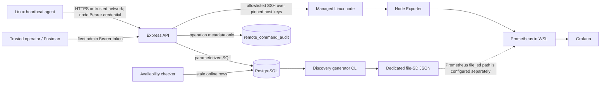

# Architecture

## Components and trust boundaries

The node credential authenticates only that node's heartbeat and credential lifecycle requests. Remote operations use a separate `FLEET_ADMIN_TOKEN`. The API does not accept arbitrary shell commands: the operation name selects one fixed diagnostic command.

## Data model

- `nodes` stores identity, management IP, heartbeat state, and optional exporter address/port.
- `node_credentials` stores only a SHA-256 digest of a random per-node credential.
- `remote_command_audit` stores the node snapshot, target, operation, status, timestamps, exit code, and a bounded error code. It does not store tokens or command output.

Database startup applies the additive, idempotent migrations under `database/migrations`. Existing node records are retained.

## Availability flow

1. The heartbeat route validates the node ID and verifies that node's Bearer credential.
2. A valid heartbeat sets `last_seen_at = NOW()` and `status = 'online'`.
3. The availability checker marks only online nodes with a non-null heartbeat older than `HEARTBEAT_TIMEOUT_SECONDS` as offline.
4. A later valid heartbeat restores the node to online.

The timeout defaults to 30 seconds and the checker interval to 10 seconds. Offline marking can occur up to one checker interval after the timeout.

## Remote-operation flow

1. `requireFleetOperator` checks `FLEET_ADMIN_TOKEN` with a timing-safe hash comparison.
2. The controller validates the node ID and operation enum and resolves the node's stored IP.
3. An audit row is created before connecting.
4. OpenSSH is spawned with `shell: false`, batch mode, password authentication disabled, strict host-key checking, and a 5-second connection timeout.
5. The process is terminated after 10 seconds; at most 8 KiB of standard output is returned.
6. The audit row is updated with outcome and exit code.

Approved operations: `uptime`, `disk_usage`, `memory_usage`, and `kernel_info`. They are read-only diagnostics. Extending this list requires code review and tests for the exact new operation.

## Monitoring boundary

`scripts/generate-prometheus-discovery.js` reads configured endpoints for every node, including offline nodes, and writes a separate file atomically. It does not configure or reload Prometheus. The active Prometheus and Grafana configuration currently lives outside this repository in WSL; this repository intentionally does not overwrite it.
