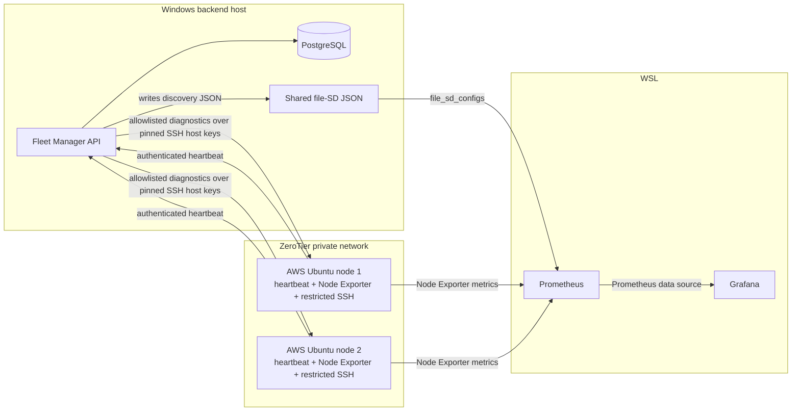

# Live Demonstration Guide

This guide provides a repeatable walkthrough for company reviewers. Use a prepared demonstration environment with two registered Ubuntu test nodes, a running Windows Fleet Manager backend, PostgreSQL, a private ZeroTier network, Prometheus in WSL, and Grafana.

The project records node inventory and authenticated heartbeats, marks stale nodes offline, publishes configured exporter targets for Prometheus, visualizes scraped metrics through Grafana, and offers a fixed set of SSH diagnostics with audit history. The repository does not create AWS instances, configure ZeroTier, install Prometheus or Grafana, or provision Grafana dashboards. Those components must be prepared separately; see [the setup guide](setup-guide.md).

## 1. What reviewers will see

During the demo, reviewers will see:

- A health response from the Express API and two registered nodes with recent heartbeat timestamps.
- A private path from each Ubuntu node to the backend through ZeroTier.
- Prometheus scraping Node Exporter on both nodes using the generated file-based target list.
- A Grafana dashboard showing host metrics for the two nodes.
- One Node Exporter scrape becoming unavailable when the service is stopped on a test node, then recovering when restarted.
- A successful allowlisted SSH diagnostic requested through the API, followed by its audit history entry.

The Fleet Manager heartbeat status and Prometheus scrape status are separate signals. In particular, Prometheus `up` reports scrape success for a target; it does not report whether the node's heartbeat is current.

## 2. Architecture at a glance



The Windows API and PostgreSQL are connected on the backend host. ZeroTier provides private connectivity only after an administrator installs clients, joins the network, authorizes members, and allows the necessary traffic. WSL Prometheus must be able to read the shared discovery file and reach both exporters. See [the architecture document](architecture.md) for trust boundaries.

## 3. Before the live session

Prepare these values privately and keep them out of slides, screenshots, and terminal recordings:

- Backend port (the repository template uses `5000`; the code default is `3000`).
- Windows backend and two node ZeroTier managed addresses.
- Each registered node ID and its individual node credential.
- Fleet operator token, available to the API client without printing it.
- A working per-node SSH mapping and verified host keys if you plan to show diagnostics.
- Prometheus and Grafana URLs and the dashboard you imported or built.

Confirm Node Exporter is installed as `node_exporter.service` on both demonstration nodes. The remote operation `node_exporter_status` expects that exact systemd service name. Keep a shell session open on the test node where you will stop and restart it.

Do a complete rehearsal before reviewers arrive. Confirm the monitoring dashboard has recent data and the remote command succeeds. A company's live network, firewall policy, AWS capacity, and shared Grafana dashboard can affect results independently of the application.

## 4. Complete startup sequence

Start or verify components in this order. Use the port and paths configured for your environment; angle-bracket values below are placeholders.

### 4.1 Verify private network membership

**Windows PowerShell** (run an elevated shell if required by the ZeroTier CLI):

```powershell
zerotier-cli status
zerotier-cli listnetworks
```

**Ubuntu shell on each AWS node:**

```sh
sudo zerotier-cli status
sudo zerotier-cli listnetworks
```

Confirm the Windows host and both node members are authorized and show their expected managed addresses. ZeroTier is configured outside this project.

### 4.2 Start PostgreSQL and the backend

Start the PostgreSQL Windows service through Windows Services or your approved database tooling. Confirm the `.env` database settings point to it. The backend checks the connection and applies the schema and migrations at startup.

**Windows PowerShell**, from the repository root:

```powershell
npm start
```

Expected result: startup logs indicate PostgreSQL is connected, the schema is ready, and the API is listening on the selected port. If automatic Prometheus publishing is configured, the log should also show an initial discovery refresh.

In a second **Windows PowerShell** window, check backend health:

```powershell
Invoke-RestMethod -Uri "http://127.0.0.1:<BACKEND_PORT>/api/health"
```

Expected result: JSON with `success: true` and the API running message.

### 4.3 Start Node Exporter and heartbeat on each Ubuntu node

**Ubuntu shell on each node:**

```sh
sudo systemctl start node_exporter.service
sudo systemctl status node_exporter.service --no-pager
```

Expected result: the service is active. Confirm the exporter responds locally:

```sh
curl --max-time 5 http://127.0.0.1:9100/metrics
```

Then start the project's heartbeat script in a separate shell on each node. Substitute the registered ID, that node's own credential, and the backend's reachable ZeroTier address and port:

```sh
export NODE_ID='<NODE_ID>'
export NODE_TOKEN='<THIS_NODES_CREDENTIAL>'
export API_BASE_URL='http://<BACKEND_ZEROTIER_IP>:<BACKEND_PORT>'
export HEARTBEAT_INTERVAL_SECONDS='10'
bash ./heartbeat.sh
```

The script is `scripts/heartbeat.sh`; copy it to the node using your approved method. Expected result: it prints a successful heartbeat after each HTTP `200` response, approximately every 10 seconds. Keep it running during the demo.

### 4.4 Start WSL Prometheus

Confirm the backend discovery file exists at the WSL-mounted path and Prometheus `prometheus.yml` references it under `file_sd_configs`. The path on WSL may differ from the backend's Windows path. The file must contain exporter targets reachable from WSL.

**WSL/Linux shell**, from the Prometheus installation directory:

```sh
./prometheus --config.file=<PROMETHEUS_CONFIG_DIRECTORY>/prometheus.yml
```

Expected result: Prometheus starts without a configuration error. Open `http://localhost:9090/targets`; the node job should show both targets. Each should be `UP` when the exporter is reachable.

### 4.5 Start Grafana

Grafana is installed separately and is not provisioned by this repository. If it was installed as a WSL systemd service and systemd is enabled, start it in **WSL/Linux**:

```sh
sudo systemctl start grafana-server
sudo systemctl status grafana-server --no-pager
```

Otherwise, start it using the method chosen during installation. Open the configured Grafana URL (commonly `http://localhost:3000` for a local setup). Confirm its Prometheus data source points to the Prometheus server reachable from the Grafana process (commonly `http://localhost:9090` when both are in the same WSL network environment) and that the prepared dashboard loads.

## 5. Verify both nodes are connected

The operator token is required for listing nodes and retrieving node details. Load it into the PowerShell session from your approved secret store without echoing it. The variable below is a placeholder variable, not a token value.

**Windows PowerShell:**

```powershell
$OperatorHeaders = @{ Authorization = "Bearer $OperatorToken" }
Invoke-RestMethod -Uri "http://127.0.0.1:<BACKEND_PORT>/api/nodes" -Headers $OperatorHeaders
```

Expected result: the list contains both registered nodes. Record their actual IDs privately, then inspect each:

```powershell
Invoke-RestMethod -Uri "http://127.0.0.1:<BACKEND_PORT>/api/nodes/<NODE_ID>" -Headers $OperatorHeaders
```

Expected result for each node: a successful response with `status` set to `online` and a recent `last_seen_at`. A new valid heartbeat updates these fields. The availability checker uses a default 30-second timeout and polls every 10 seconds, so an offline transition can occur after the timeout plus up to one polling interval.

In **WSL/Linux**, independently verify each exporter from the address Prometheus uses:

```sh
curl --max-time 5 http://<NODE_1_EXPORTER_ADDRESS>:9100/metrics
curl --max-time 5 http://<NODE_2_EXPORTER_ADDRESS>:9100/metrics
```

Expected result: each returns Prometheus text metrics. In `http://localhost:9090/targets`, both node targets should be listed and healthy. A healthy Prometheus target does not itself prove that the Fleet Manager heartbeat is current; use the node details API for heartbeat status.

## 6. Explain the Grafana dashboard panels

Dashboard layout and panel names depend on the dashboard separately installed for the demo; this repository does not include dashboard JSON. Use the following explanations for standard panels backed by Node Exporter metrics:

| Panel | What it shows | Example Prometheus query |
|---|---|---|
| CPU utilization | Approximate percentage of CPU time not spent idle, grouped by node. | `100 * (1 - avg by (instance) (rate(node_cpu_seconds_total{mode="idle"}[5m])))` |
| Memory utilization | Percentage of total RAM not currently available to applications and the kernel. | `100 * (1 - node_memory_MemAvailable_bytes / node_memory_MemTotal_bytes)` |
| Disk utilization | Percentage of filesystem space in use. Filter pseudo filesystems/mounts according to the imported dashboard. | `100 * (1 - node_filesystem_avail_bytes / node_filesystem_size_bytes)` |
| Uptime | Time elapsed since the node boot timestamp reported by Node Exporter. | `time() - node_boot_time_seconds` |
| Node Exporter availability | Whether Prometheus's latest scrape of each exporter succeeded. | `up{job="linux-nodes"}` |

Queries may need label or job-name adjustments to match the `prometheus.yml` and imported dashboard. Explain units on screen: CPU, memory, and disk utilization are percentages; uptime is seconds unless the panel formats it into days/hours; `up` is `1` for a successful scrape and `0` for a failed scrape. **The `up` metric measures Node Exporter scrape availability, not heartbeat status.** Heartbeat state is shown by the Fleet Manager node details API.

Expected result: two series/rows/instances for each panel, one per node, provided the dashboard's filters match the labels in the discovery file and both exporters have been scraped.

## 7. Demonstrate one node going DOWN and recovering

Choose one test node and tell reviewers which one. This procedure stops only Node Exporter; it leaves the node's heartbeat script running. Do not use a production node.

1. Confirm both nodes are initially `UP` on Prometheus `/targets` and visible in Grafana.
2. On the selected node, run in **Ubuntu shell**:

   ```sh
   sudo systemctl stop node_exporter.service
   sudo systemctl status node_exporter.service --no-pager
   ```

3. Wait for Prometheus's next scrape or two. Its `up` result for that node should become `0` (or the target may be marked down in `/targets`). Node Exporter dependent panels for that node may show no fresh samples or a gap.
4. Recheck the node in the Fleet Manager API. Because the heartbeat process is still running, its heartbeat status should normally remain `online` with a recent `last_seen_at`. This makes the distinction between heartbeat connectivity and metrics scrape availability visible.
5. Restart the service immediately in **Ubuntu shell**:

   ```sh
   sudo systemctl start node_exporter.service
   sudo systemctl status node_exporter.service --no-pager
   ```

6. Wait for the next scrape. Expected result: Prometheus target returns to `UP`, `up` returns to `1`, and metric panels resume displaying data.

If the API heartbeat also stops, the backend marks that node offline only after `HEARTBEAT_TIMEOUT_SECONDS` (default 30 seconds) plus up to `OFFLINE_CHECK_INTERVAL_SECONDS` (default 10 seconds). Do not describe the Prometheus `up` change as a heartbeat failure.

## 8. Demonstrate an approved SSH diagnostic

Run this only after SSH setup has been completed and rehearsed: OpenSSH is available on Windows, each target has a validated `FLEET_SSH_NODES` mapping, host keys are independently verified and in the backend account's `known_hosts`, and the Ubuntu forced-command account/wrapper is installed. The backend uses strict host-key checking and does not accept arbitrary commands.

Load the operator token into `$OperatorHeaders` using the same approved secret source described earlier. In **Windows PowerShell**, invoke the safe `uptime` operation:

```powershell
$Body = @{ operation = 'uptime' } | ConvertTo-Json
Invoke-RestMethod -Method Post `
  -Uri "http://127.0.0.1:<BACKEND_PORT>/api/nodes/<NODE_ID>/commands" `
  -Headers $OperatorHeaders `
  -ContentType 'application/json' `
  -Body $Body
```

Expected result: HTTP success, `status` equal to `succeeded`, the selected node ID/name, and the remote uptime output. The output is returned to the authorized caller but is not stored in command history.

The currently approved operation names are `uptime`, `disk_usage`, `memory_usage`, `kernel_info`, `disk_usage_all`, `memory_usage_mb`, and `node_exporter_status`. The API accepts one `operation` field and rejects additional command text or arguments. The request runs through OpenSSH with `shell: false`, explicit per-node identity, batch mode, password authentication disabled, strict host-key checking, a timeout, and a combined output cap.

For an optional failure demonstration, run `node_exporter_status` while the selected service is stopped. It may return an unsuccessful remote-operation response because `systemctl status` reports a stopped service as non-zero. Then restart Node Exporter as above. Avoid intentionally testing arbitrary commands during a company demonstration.

## 9. Show command history and audit records

### API history

**Windows PowerShell**, using the operator headers:

```powershell
Invoke-RestMethod -Uri "http://127.0.0.1:<BACKEND_PORT>/api/nodes/commands/history?node_id=<NODE_ID>&limit=25&offset=0" -Headers $OperatorHeaders
```

Expected result: newest audit records first, including node ID/name, approved operation, status, request/completion timestamps, exit code, and error code. The API response omits target addresses, credentials, and command output. The history endpoint requires the fleet operator token.

### PostgreSQL audit table (optional)

For a database-level view, use your normal PostgreSQL access method and run a read-only query:

```sql
SELECT requested_at, node_id, node_name, operation, status,
       completed_at, exit_code, error_code
FROM remote_command_audit
ORDER BY requested_at DESC, id DESC
LIMIT 10;
```

Expected result: an audit row per attempted approved operation, first created with `running` status and then updated with its result. The audit records metadata and outcome; they do not persist the diagnostic output or bearer credentials.

## 10. Troubleshooting during the demo

| Symptom | Check |
|---|---|
| Backend health check fails | Confirm PostgreSQL is running and reachable, `.env` has the correct DB settings and `PORT`, startup completed, and Windows Firewall permits your local/trusted client. |
| Node missing or offline in API | Confirm the node is registered, its heartbeat script is running with its own credential and correct backend URL, and ZeroTier routing/firewall permits the request. Allow for the configured timeout and polling delay. |
| Node Exporter URL or Prometheus target fails | Test port `9100` from WSL, confirm `node_exporter.service` is active, and check WSL routing, ZeroTier paths, target address, and `file_sd_configs` path. |
| Target absent from Prometheus | Confirm exporter endpoint was provisioned for the node, backend discovery output is configured and refreshed, Prometheus can read the same file through its WSL path, and the scrape job references it. |
| Grafana panel is blank | Confirm the data source test succeeds, Prometheus has recent samples, panel filters and metric names fit the actual dashboard, and the time range includes the scrape period. |
| Operator route returns `401` or `503` | `401` usually means missing/invalid bearer credentials; `503` indicates operator authentication is not configured correctly in the running backend. |
| SSH operation returns `503` | The node's per-ID SSH mapping is absent or invalid. Check the local backend configuration and restart the backend after changes. |
| SSH operation fails | Check Windows OpenSSH, node reachability on port `22`, independently pinned host key, private-key ACL, forced-command account/wrapper, and exact node ID-to-key mapping. Do not disable strict host-key checking to work around this. |
| SSH output says operation rejected | Confirm the wrapper is installed at the configured forced-command path and matches this repository's `scripts/fleet-command-wrapper.sh`. The command string must be one of the fixed operations. |

If an external service or network path is unhealthy, state which layer is affected and continue with parts of the demonstration that remain available. Avoid making claims based on an unverified screenshot or stale dashboard data.

## 11. Safe shutdown

1. On each Ubuntu node, stop the heartbeat script with `Ctrl+C` in its terminal. Stop it after the recovery step so it does not leave stale heartbeats during the walkthrough.
2. Confirm the selected node's Node Exporter has been restarted and is active:

   ```sh
   sudo systemctl start node_exporter.service
   sudo systemctl status node_exporter.service --no-pager
   ```

3. Stop Prometheus in its WSL terminal with `Ctrl+C`, or stop the separately configured service.
4. Stop Grafana using the service/process method used for installation.
5. Stop the backend with `Ctrl+C` in its PowerShell window. Its signal handler stops background services and closes the HTTP server and PostgreSQL pool.
6. Leave a shared PostgreSQL service running. Stop it only if dedicated to the demo and approved for shutdown. Do not remove AWS instances, database contents, keys, or ZeroTier memberships as part of routine process shutdown.

## 12. Reviewer checklist

- [ ] Backend health endpoint returns success.
- [ ] Both registered nodes show recent heartbeat timestamps and `online` status in the Fleet Manager API.
- [ ] Both Node Exporter endpoints respond and are listed as `UP` in Prometheus.
- [ ] Grafana connects to Prometheus and displays CPU, memory, disk, uptime, and exporter availability for both nodes.
- [ ] Reviewer understands that Prometheus `up` is exporter scrape health, separate from Fleet Manager heartbeat status.
- [ ] Stopping Node Exporter on a test node makes its Prometheus target/panel unavailable, while the heartbeat can remain online.
- [ ] Restarting Node Exporter restores its Prometheus target and panels.
- [ ] An approved SSH diagnostic succeeds and returns output to the authorized caller.
- [ ] Command history/audit shows the operation and outcome without command output or credentials.
- [ ] No passwords, tokens, private keys, AWS credentials, or real infrastructure addresses appear in shared notes or screenshots.
- [ ] All demonstration services and the test node are left in a safe state after shutdown.
